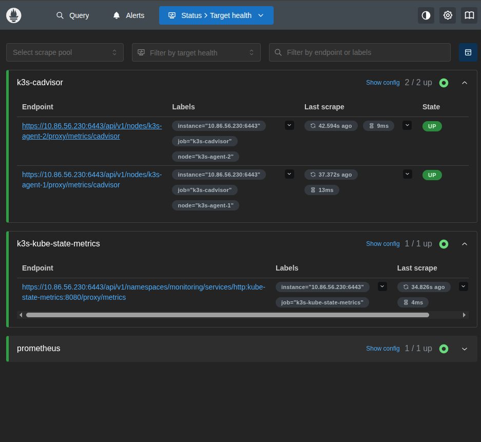
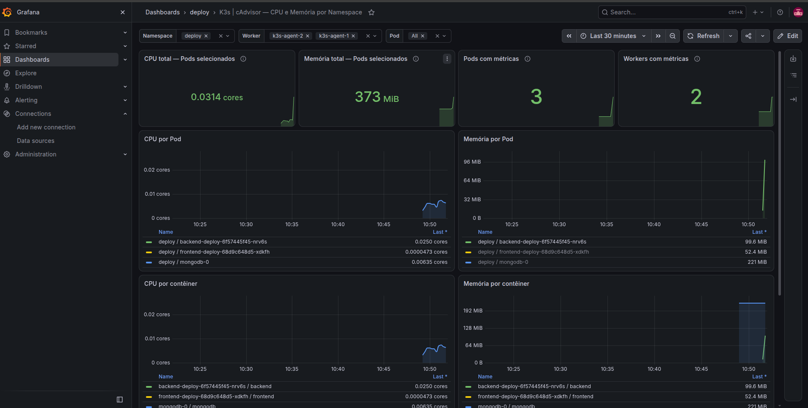

# Laboratório K3s com observabilidade

Prova de conceito para executar uma aplicação React, Node.js e MongoDB em um cluster K3s local, com métricas no Prometheus e Grafana. O objetivo é estudar a infraestrutura, escalonamento e manipulacao de recursos usados pelas aplicacoes.
- `backend/` e `frontend/`: código e Dockerfiles da aplicação.
- `manifests/`: recursos Kubernetes.
- `monitoring/`: Docker Compose e configuração do Prometheus.

## Arquitetura

```text
Ubuntu host
├── LXD
│   ├── k3s-control-panel (Control Plane)
│   ├── k3s-agent-1 (Worker)
│   └── k3s-agent-2 (Worker)
└── Docker Compose
    ├── Prometheus
    └── Grafana
```

No cluster, o navegador acessa o frontend (React e Caddy), que encaminha `/api/*` ao backend. O backend usa o MongoDB, cujo volume persiste por meio de um PVC `local-path`. Os Pods podem ser agendados em qualquer um dos três nós.

O Prometheus roda no host e consulta cAdvisor e kube-state-metrics pelo API Server do K3s, usando uma ServiceAccount com permissões RBAC. O Grafana lê as métricas do Prometheus.

### Recursos Kubernetes usados

| Recurso | O que faz neste projeto |
| --- | --- |
| Pod | Executa os contêineres da aplicação ou do monitoramento. |
| Deployment | Define imagem, réplicas e configuração dos Pods do frontend e backend; mantém esses Pods em execução. |
| Service | Fornece um endereço e uma porta estáveis para acessar os Pods. |
| StatefulSet | Gerencia o Pod do MongoDB com identidade e armazenamento estáveis. |
| PVC | Solicita o volume persistente usado pelo MongoDB. |
| ConfigMap | Guarda configurações não sensíveis do frontend e backend. |
| Secret | Fornece o `JWT_SECRET` ao backend; é criado separadamente dos manifestos. |
| Namespace | Separa a aplicação (`deploy`) do monitoramento (`monitoring`). |
| ServiceAccount e RBAC | Dão ao Prometheus uma identidade e permissão para consultar métricas pelo API Server. |

### Services Kubernetes

| Service | Porta | Função |
| --- | --- | --- |
| `frontend-service` (`deploy`) | NodePort `30080` → Caddy `80` | Expõe o frontend; o acesso por port-forward descrito abaixo usa a porta local `8080`. |
| `backend-deploy` (`deploy`) | ClusterIP `3003` | Recebe as requisições `/api/*` do Caddy pelo endereço `backend-deploy:3003`. |
| `mongo-service` (`deploy`) | Headless `27017` | Permite ao backend localizar o MongoDB pelo endereço `mongo-service:27017`. |
| `kube-state-metrics` (`monitoring`) | Interna `8080` | Criado pelo Helm; o Prometheus consulta suas métricas pelo API Server. |

`backend-deploy` é também o nome do Deployment. Na configuração do Caddy, esse endereço aponta para o **Service**.

## Pré-requisitos

- Ubuntu com LXD, Docker Engine e Docker Compose.
- Virtualização disponível e recursos suficientes para três VMs.
- Rede entre as VMs e acesso do host ao Control Plane.

Os comandos abaixo indicam onde executar cada etapa. Substitua os valores de IP e token pelos do seu ambiente.

## 1. Criar o cluster

**No Ubuntu host**, inicialize o LXD se necessário e crie as VMs:

```bash
lxd init
lxc launch ubuntu:24.04 k3s-control-panel --vm -c limits.cpu=2 -c limits.memory=2GiB
lxc launch ubuntu:24.04 k3s-agent-1 --vm -c limits.cpu=2 -c limits.memory=2GiB
lxc launch ubuntu:24.04 k3s-agent-2 --vm -c limits.cpu=2 -c limits.memory=3GiB
lxc list
```

Use o IPv4 mostrado em `lxc list` para a VM `k3s-control-panel`. As VMs precisam acessar a internet e a porta TCP 6443 do Control Plane precisa estar acessível aos Workers.

**No Ubuntu host**, abra um shell na VM Control Plane. Os comandos seguintes, até `exit`, rodam dentro da VM:

```bash
lxc exec k3s-control-panel -- bash
curl -sfL https://get.k3s.io | sh -
k3s kubectl get nodes
cat /var/lib/rancher/k3s/server/node-token
exit
```

**Em cada Worker**, abra um shell com `lxc exec k3s-agent-1 -- bash` (depois repita com `k3s-agent-2`):

```bash
export K3S_URL="https://IP_DO_CONTROL_PLANE:6443"
export K3S_TOKEN="TOKEN_DO_CONTROL_PLANE"
curl -sfL https://get.k3s.io | sh -
exit
```

Confira os três nós a partir do host:

```bash
lxc exec k3s-control-panel -- k3s kubectl get nodes -o wide
```

## 2. Construir e importar as imagens

**No Ubuntu host**, na raiz do repositório:

```bash
docker build -t back-deploy:v1 ./backend
docker build -t front:v1 ./frontend
docker save -o /tmp/backend.tar back-deploy:v1
docker save -o /tmp/frontend.tar front:v1
```

Copie e importe as duas imagens **no Control Plane**:

```bash
lxc file push /tmp/backend.tar k3s-control-panel/root/backend.tar
lxc file push /tmp/frontend.tar k3s-control-panel/root/frontend.tar
lxc exec k3s-control-panel -- k3s ctr -n k8s.io images import /root/backend.tar
lxc exec k3s-control-panel -- k3s ctr -n k8s.io images import /root/frontend.tar
```

Repita **no Worker 1**:

```bash
lxc file push /tmp/backend.tar k3s-agent-1/root/backend.tar
lxc file push /tmp/frontend.tar k3s-agent-1/root/frontend.tar
lxc exec k3s-agent-1 -- k3s ctr -n k8s.io images import /root/backend.tar
lxc exec k3s-agent-1 -- k3s ctr -n k8s.io images import /root/frontend.tar
```

Repita **no Worker 2**:

```bash
lxc file push /tmp/backend.tar k3s-agent-2/root/backend.tar
lxc file push /tmp/frontend.tar k3s-agent-2/root/frontend.tar
lxc exec k3s-agent-2 -- k3s ctr -n k8s.io images import /root/backend.tar
lxc exec k3s-agent-2 -- k3s ctr -n k8s.io images import /root/frontend.tar
```

Os Deployments usam `imagePullPolicy: Never`. Como não há regra de agendamento por nó, as duas imagens precisam estar disponíveis nos três nós. O MongoDB (`mongo:8`) é baixado do registry público.

## 3. Implantar a aplicação

**No Ubuntu host**, copie os manifestos para o Control Plane:

```bash
lxc file push manifests/back-config.yaml k3s-control-panel/root/
lxc file push manifests/front-config.yaml k3s-control-panel/root/
lxc file push manifests/mongo.yaml k3s-control-panel/root/
lxc file push manifests/backend.yaml k3s-control-panel/root/
lxc file push manifests/frontend.yaml k3s-control-panel/root/
lxc file push manifests/prometheus-rbac.yaml k3s-control-panel/root/
lxc file push manifests/prometheus-ksm-rbac.yaml k3s-control-panel/root/
```

**No Ubuntu host**, entre no Control Plane. Os comandos seguintes rodam dentro da VM:

```bash
lxc exec k3s-control-panel -- bash
k3s kubectl create namespace deploy
k3s kubectl create namespace monitoring
k3s kubectl apply -f /root/back-config.yaml -f /root/front-config.yaml
```

Prepare nessa VM um arquivo local `/root/backend-secret.env` com `JWT_SECRET=` seguido de uma string aleatória de pelo menos 32 caracteres. Não coloque esse arquivo no Git. Crie o Secret usado pelo Deployment:

```bash
k3s kubectl -n deploy create secret generic backend-secret \
  --from-env-file=/root/backend-secret.env
```

Aplique os recursos e confira o resultado:

```bash
k3s kubectl apply -f /root/mongo.yaml
k3s kubectl apply -f /root/backend.yaml -f /root/frontend.yaml
k3s kubectl get deploy,sts,svc,pods,pvc -n deploy -o wide
```

O MongoDB deste laboratório não tem autenticação. O backend usa o Secret `backend-secret` para assinar os tokens JWT.

Para acessar pelo Ubuntu host, mantenha este comando rodando **no Control Plane**:

```bash
k3s kubectl -n deploy port-forward svc/frontend-service 8080:80 --address 0.0.0.0
```

Abra `http://IP_DO_CONTROL_PLANE:8080` no navegador. O Caddy preserva o prefixo `/api`, como esperado pelas rotas do backend.

## 4. Configurar o monitoramento

**Em outro terminal no Ubuntu host**, entre no Control Plane. Instale o Helm se necessário e depois o kube-state-metrics:

```bash
lxc exec k3s-control-panel -- bash
curl -fsSLo get_helm.sh https://raw.githubusercontent.com/helm/helm/main/scripts/get-helm-3
chmod 700 get_helm.sh
./get_helm.sh
export KUBECONFIG=/etc/rancher/k3s/k3s.yaml
helm repo add prometheus-community https://prometheus-community.github.io/helm-charts
helm repo update
helm upgrade --install kube-state-metrics prometheus-community/kube-state-metrics -n monitoring
k3s kubectl get pods,svc -n monitoring
```

Aplique as permissões para o Prometheus externo:

```bash
k3s kubectl apply -f /root/prometheus-rbac.yaml
k3s kubectl apply -f /root/prometheus-ksm-rbac.yaml
exit
```

**No Ubuntu host**, copie a configuração de exemplo e ajuste nela o IP `192.0.2.10` e os nomes dos nós para os valores reais:

```bash
cp monitoring/prometheus/prometheus.yml.example monitoring/prometheus/prometheus.yml
```

Gere o token da ServiceAccount e copie a CA do K3s:

```bash
mkdir -p monitoring/prometheus/credentials
lxc exec k3s-control-panel -- \
  k3s kubectl create token prometheus-external -n monitoring --duration=168h \
  > monitoring/prometheus/credentials/token
lxc exec k3s-control-panel -- \
  cat /var/lib/rancher/k3s/server/tls/server-ca.crt \
  > monitoring/prometheus/credentials/ca.crt
sudo chown root:65534 monitoring/prometheus/credentials/token monitoring/prometheus/credentials/ca.crt
sudo chmod 640 monitoring/prometheus/credentials/token monitoring/prometheus/credentials/ca.crt
docker compose -f monitoring/compose.yaml up -d
```

Prometheus: `http://localhost:9090`. Grafana: `http://localhost:3000`. No Grafana, configure o Prometheus como fonte de dados usando `http://prometheus:9090`.

O token gerado dura até sete dias; renove-o quando expirar. Os arquivos de credenciais e a configuração local do Prometheus são ignorados pelo Git.

### Targets do Prometheus

Os targets do cAdvisor, kube-state-metrics e Prometheus em funcionamento:



### Dashboard do Grafana

Métricas de CPU e memória dos Pods no namespace `deploy`:


